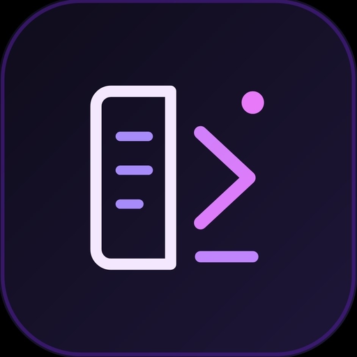

<div align="center">



# ЛинТех 28

**Электронный дневник школы №28 — Android, браузер и ПК**

<a href="https://bossbabos354.github.io/lintech-diary/"></a>
<a href="https://bossbabos354.github.io/lintech-diary/diary/"></a>
<a href="https://github.com/Bossbabos354/lintech-diary/releases/latest"></a>
<a href="https://github.com/Bossbabos354/lintech-diary/releases"></a>

</div>

---

## О проекте

ЛинТех 28 — неофициальный клиент школьного журнала АВЕРС. Приложение забирает
оценки, домашние задания и расписание и показывает их в аккуратном интерфейсе
с дизайном в духе iOS 26: стеклянные карточки, мягкие анимации, светлая,
тёмная и «книжная» темы.

Один и тот же дневник доступен на трёх платформах:

| Платформа | Что это | Как открыть |
|---|---|---|
| Android | Нативное приложение на Kotlin + Jetpack Compose | [APK последнего релиза](https://github.com/Bossbabos354/lintech-diary/releases/latest) |
| Браузер | Веб-версия без установки, тот же интерфейс | [bossbabos354.github.io/lintech-diary/diary](https://bossbabos354.github.io/lintech-diary/diary/) |
| Windows / Linux | Десктопная версия на Compose Desktop | `.msi`, `.deb`, `.rpm` из [релизов](https://github.com/Bossbabos354/lintech-diary/releases) |

## Возможности

- **Оценки.** Средний балл считается как в журнале: по весам и только за
  текущий период, с точностью до сотых. Видно, какие предметы проседают.
- **Цели по предметам.** «Нужно ещё 2 пятёрки, чтобы выйти на 4» — расчёт с
  учётом весов и выбранных допустимых оценок.
- **Дневник.** Темы уроков, домашние задания и галочки «сделано» прямо в
  списке уроков.
- **Расписание.** 55 классов, звонки, кабинеты и учителя; данные лежат в
  репозитории и обновляются без пересборки приложения.
- **Итоги дня и недели.** Средний балл, лучший предмет, прогресс по домашке.
- **События.** Школьная афиша с объявлениями и ссылками.
- **Оформление.** Системная, светлая, тёмная и книжная темы, фон приложения.
- **Поиск** по предметам, темам уроков и домашним заданиям.
- **Экспорт.** Оценки и дневник в CSV, расписание в ICS, цели в JSON.
- **Уведомления** о новых оценках и настройки тихих часов.

## Оформление

<div align="center">
  
  <br>
  <sub>Фон темы «Книжная»</sub>
</div>

Сам интерфейс проще посмотреть живьём, без установки — в
[веб-версии](https://bossbabos354.github.io/lintech-diary/diary/).

## Структура репозитория

| Папка | Назначение |
|---|---|
| `ios26-redesign/` | Android-приложение: Kotlin, Jetpack Compose, виджеты, тёмная и книжная темы |
| `web/` | Сайт и веб-версия дневника: `diary/`, лендинг, админка, данные в `data/` |
| `web/yandex/` | Прокси к журналу для веба (Yandex Cloud Functions) |
| `desktop/` | Десктопная версия на Compose Desktop |
| `updateserver/` | Старый сервер обновлений |

## Сборка

### Android

```bash
cd ios26-redesign
./gradlew :app:assembleDebug      # APK для проверки
./gradlew :app:assembleRelease    # релизная сборка
```

Подпись берётся из `signing.properties` (файл и ключ в репозиторий не попадают).

### Веб-версия

Статический сайт без сборки: откройте `web/index.html` или раздайте папку любым
HTTP-сервером.

```bash
cd web
python3 -m http.server 8000
```

Вход в журнал идёт через прокси `web/yandex/index.js`, развёрнутый в Yandex
Cloud Functions: браузер не может отправить нужные журналу cookie напрямую.

### ПК

```bash
cd desktop
./gradlew run
./gradlew packageDeb          # Debian/Ubuntu
./gradlew packageRpmWithMenu  # Fedora/RHEL
./gradlew packageMsi          # Windows + WiX Toolset 3
```

## Данные

Расписание и события лежат в репозитории и правятся через админку:

- [`web/data/schedule.json`](web/data/schedule.json) — классы, звонки, уроки;
- [`web/data/events.json`](web/data/events.json) — школьные события.

Админка: [bossbabos354.github.io/lintech-diary/tools.html](https://bossbabos354.github.io/lintech-diary/tools.html)
(вход по паролю, правки сохраняются коммитами).

## Ссылки

- Сайт проекта: https://bossbabos354.github.io/lintech-diary/
- Веб-версия: https://bossbabos354.github.io/lintech-diary/diary/
- Релизы и APK: https://github.com/Bossbabos354/lintech-diary/releases
- Для разработчиков: https://bossbabos354.github.io/lintech-diary/developers.html

<div align="center">
  <sub>Сделано для учеников и родителей школы №28, Киров</sub>
</div>
