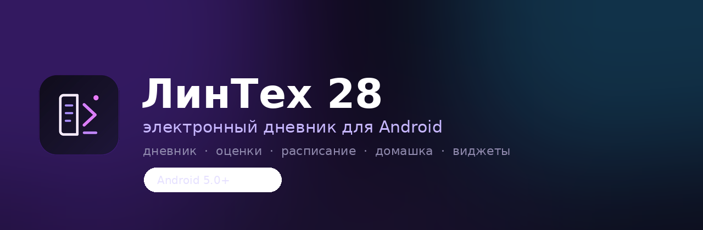
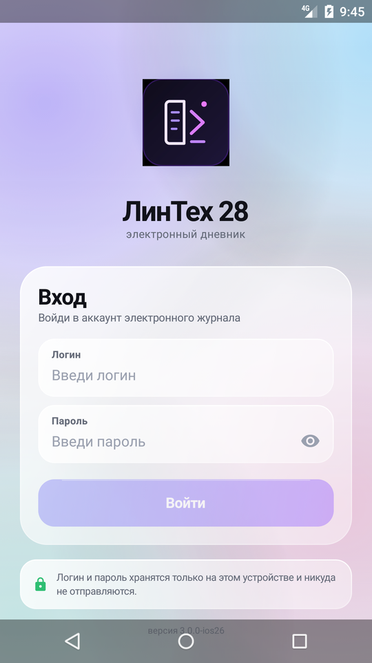
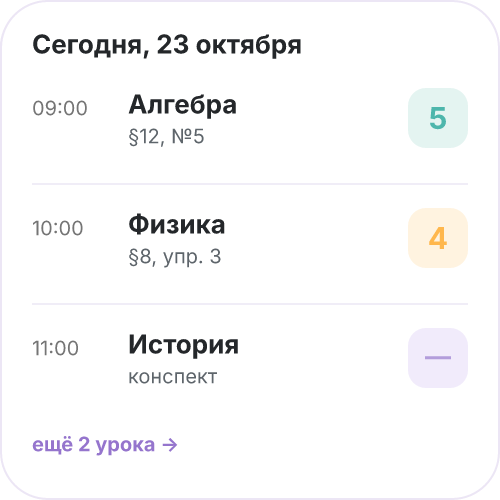
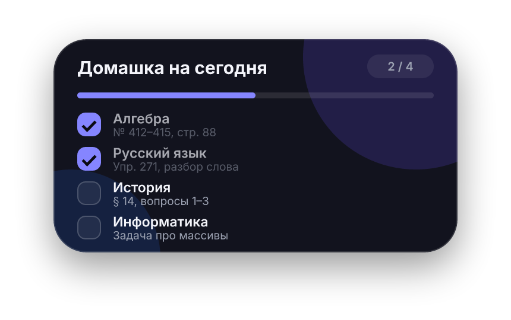
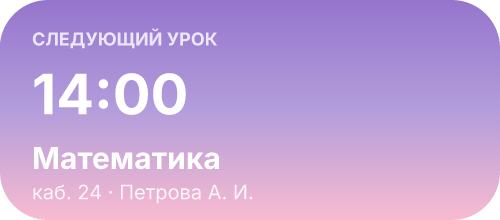

<div align="center">
  
  <br><br>

  
  
  
</div>

## Что это

**ЛинТех 28** — дневник для учеников и родителей в виде обычного Android-приложения. Он показывает то же, что и сайт электронного журнала, но в удобном виде: расписание на день, оценки, домашние задания и итоги недели. Работает без интернета на уже загруженных данных и умеет выводить главное на рабочий стол в виджетах.

## Скачать и установить

1. Откройте раздел **[Releases](../../releases/latest)** и скачайте файл `SchoolDiary_ios26.apk`.
2. Откройте скачанный файл на телефоне.
3. Если появится предупреждение — разрешите установку из этого источника: **Настройки → Безопасность → Установка неизвестных приложений**.
4. Установите приложение и откройте его.
5. Войдите логином и паролем от [электронного журнала](https://journal.school28-kirov.ru).

Обновления ставятся поверх старой версии: настройки, отметки о выполненной домашке и сохранённые данные остаются на месте.

> Приложение распространяется не через Google Play, поэтому Play Protect может попросить подтверждение. Нажмите «Всё равно установить» — это стандартное предупреждение для APK.

## Что умеет

| Раздел | Возможности |
|---|---|
| **Дневник** | уроки на день, кабинет, учитель, домашнее задание и оценки за урок |
| **Оценки** | средний балл, динамика по неделям, итоги за четверть, месяц и год, критические предметы |
| **Расписание** | вся неделя сразу, звонки и замены |
| **Итоги** | итоги дня и недели; нажатие на урок открывает дневник и подсвечивает его |
| **Домашка** | чек-лист выполненных заданий прямо в приложении и в виджете |
| **Виджеты** | 6 виджетов на рабочий стол: урок, средний балл, дневник, цель, расписание, домашка |
| **Оформление** | 4 темы, две иконки и два фона на выбор |
| **Офлайн** | последние загруженные данные открываются без интернета |

<div align="center">
  
</div>

## Виджеты

Виджеты ставятся долгим нажатием на рабочем столе → **Виджеты** → **ЛинТех 28**. Внутри приложения есть галерея с предпросмотром: **Настройки → Виджеты**.

<div align="center">
  <table>
    <tr>
      <td align="center"><br><sub>Дневник 4×4</sub></td>
      <td align="center"><br><sub>Домашка на сегодня</sub></td>
      <td align="center"><br><sub>Ближайший урок</sub></td>
    </tr>
  </table>
</div>

## Вход и данные

- Логин и пароль — те же, что на сайте электронного журнала.
- Данные для входа хранятся только на телефоне и никуда не отправляются.
- Интернет нужен, чтобы обновить оценки и расписание. Без сети приложение открывает последнюю загрузку.
- Если данные устарели, потяните список вниз — это обновление.

## Частые вопросы

**Пусто, хотя интернет есть.**
Потяните список вниз. Если не помогло — проверьте логин и пароль и попробуйте войти заново. Иногда школьный сервер недоступен: попробуйте позже.

**Забыл пароль от журнала.**
Пароль выдаёт школа — обратитесь к классному руководителю. В приложении его восстановить нельзя.

**Не устанавливается APK.**
Разрешите установку из неизвестных источников для файлового менеджера или браузера, через который открываете файл, и попробуйте снова.

**Оценки не совпадают с сайтом.**
Приложение показывает данные на момент последней загрузки. Потяните список вниз для обновления.

**Хочу другую иконку или тему.**
**Настройки → Оформление**: там меняются тема, иконка приложения и фон.

## Для разработчиков

- **Стек:** Kotlin, Jetpack Compose, Material 3, WorkManager, AppWidget (RemoteViews).
- **Минимальная версия:** Android 5.0 (API 21), целевая — 34.
- **Сборка:**

```bash
cd ios26-redesign
./gradlew :app:assembleDebug
```

- **Структура репозитория:**

| Папка | Содержимое |
|---|---|
| `ios26-redesign/app` | приложение: Compose-экраны, виджеты, работа с журналом |
| `ios26-redesign/design` | исходники макетов FigCraft |
| `updateserver` | PHP-сервер: обновления, расписание, статьи |
| `web` | статический сайт проекта |
| `app` | предыдущая версия на XML-вёрстке |

---

Проект школы №28 (Киров). Вопросы и ошибки — в разделе [Issues](../../issues).
